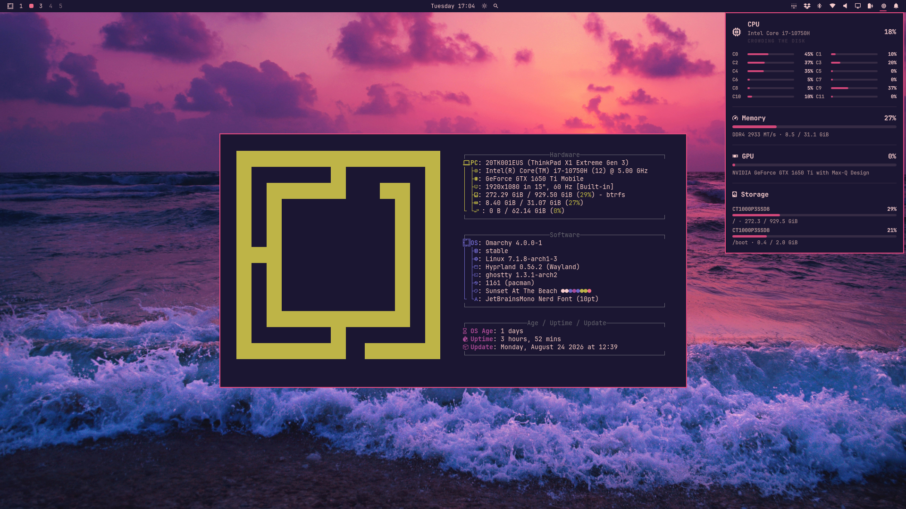

# Sunset At The Beach

This theme captures the quiet transition from day to night along a warm shoreline, where the sunset melts into deep purple skies above a calming beach. Moody light, gentle nature, and soft coastal tones come together to create a relaxed desktop atmosphere.

## Installation

```bash
omarchy theme install https://github.com/mahardhitama/omarchy-sunset-at-the-beach-theme.git
```

This clones the theme into `~/.config/omarchy/themes/sunset-at-the-beach` and applies it. To switch back to it later:

```bash
omarchy theme set sunset-at-the-beach
```

## Preview




## Wallpapers

- [brown stone near sea at golden hour](https://unsplash.com/photos/brown-stone-near-sea-at-golden-hour-vmZ2DehWQ3Q)
- [ocean waves crashing on shore during sunset](https://unsplash.com/photos/ocean-waves-crashing-on-shore-during-sunset-iAV-_wmd9ww)
- [waves crashing on purple beach](https://unsplash.com/photos/waves-crashing-on-purple-beach-DA_tplYgTow)
- [photo of seashore during golden hour](https://unsplash.com/photos/photo-of-seashore-during-golden-hour-n44KHcbp1_E)
